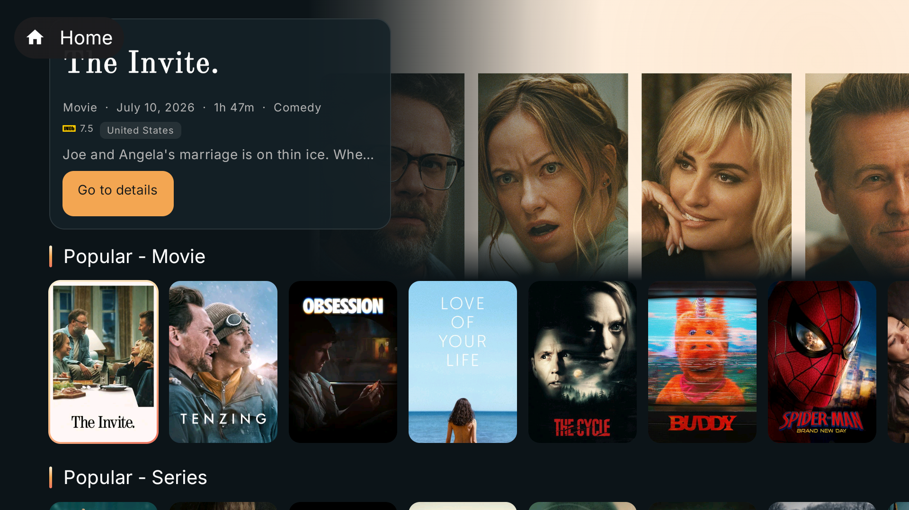
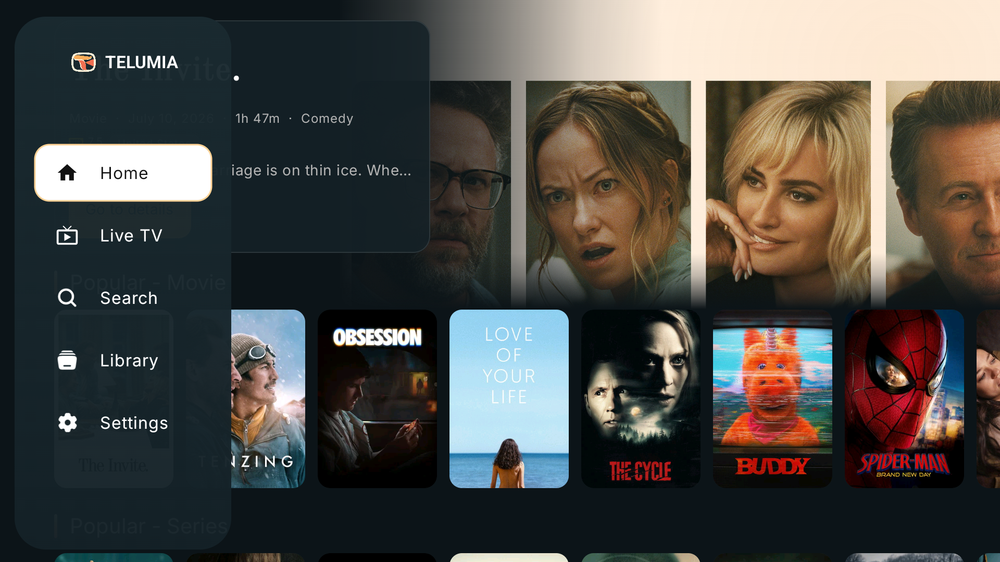
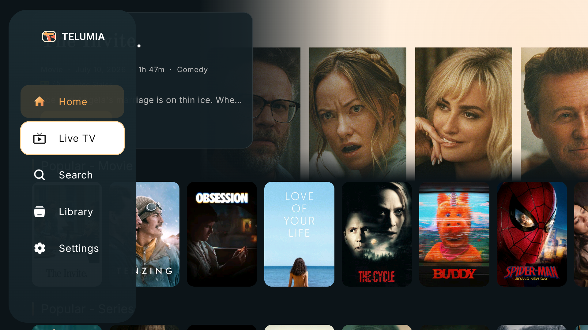
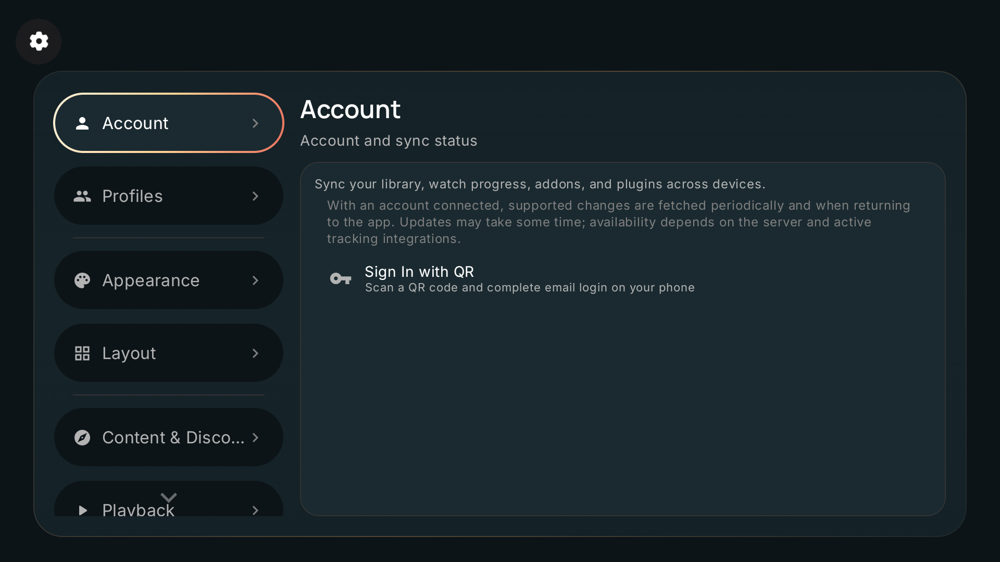
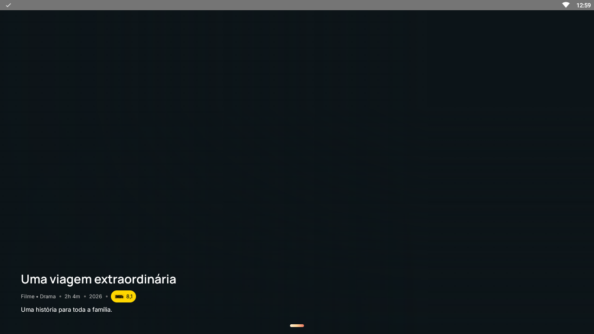

# Evolução visual Telumia TV

Esta entrega estende a atualização visual do Telumia para Android TV, com foco em leitura à distância, navegação por controle remoto e uma identidade consistente entre abertura, home e configurações.

## O que mudou

- A abertura revela a marca com entrada suave, escala e brilho ambiente; o movimento respeita as preferências de animação e redução de movimento do tema.
- A hero da home troca título e metadados com transição curta, recebe luz ambiente da paleta Telumia e oferece um botão de detalhes com foco visível. A ação usa o destino real do item focado e fica indisponível enquanto um trailer ocupa a tela.
- Os títulos das fileiras ganharam hierarquia maior e um acento vertical em âmbar/coral.
- A navegação lateral mostra o wordmark Telumia e mantém superfícies e contornos de foco legíveis para o controle remoto.
- O foco D-pad do menu lateral agora percorre alvos explícitos entre as rotas, sem escapar para os cartões da home.
- Os painéis compartilhados de configurações receberam gradientes discretos e contornos tingidos pela paleta de marca.

## Evidências no emulador

Capturas em 1920 × 1080, feitas no AVD `Telumia_TV_API33` com a variante de depuração:

O login QR do build de depuração não está configurado neste ambiente. A verificação visual foi feita após escolher “continuar sem conta” e o perfil Essential; isso permite abrir a home com conteúdo de catálogo de demonstração. A ação “ir aos detalhes” também foi exercitada pela navegação D-pad.

## Verificação

- `:app:assembleFullDebug :app:assembleFullDebugAndroidTest` — compilação bem-sucedida.
- `TelumiaHomeHeroTvTest` via `adb shell am instrument` direcionado ao AVD Android 13 TV — 3 testes, 0 falhas.
- `git diff --check` — sem erros de whitespace.
- AVD: Android 13, ABI x86. APK instalado: `app/build/outputs/apk/full/debug/app-full-x86-debug.apk` (depuração, assinatura de teste; o pacote `.debug` não atualiza o pacote estável instalado).
- SHA-256 do APK x86 validado: `61417914831DA41EA7D1C6915FC364270AD5A76ADD503562C0701CE2EF6801BB`.

O APK universal e os APKs por ABI gerados pelo Gradle também são artefatos `debug`; ainda não representam uma publicação estável.

## QA final do CTA e das configurações — 30/10/2026

- O CTA continua ancorado à esquerda do painel; o rótulo “Go to details” fica centralizado dentro do botão. O teste também valida o foco D-pad e a troca de metadados da hero.
- As configurações reutilizam os componentes existentes em Zen e Horizon. O fixture instrumentado valida o avanço de foco do menu ao item de detalhe, o contorno focado, o slider com gradiente e o aviso. O painel de detalhe é rolável em viewports compactos; em 720p a captura inicial mantém o título visível e a segunda captura mostra o aviso após a rolagem.
- A fixture renderiza componentes reais para QA. Não altera navegação, estado persistido, ciclo de vida, permissões, APIs de rede ou dependências do app. A captura usa `UiAutomation.takeScreenshot()`.
- AVD `Telumia_TV_API30`, Android 11 (API 30), ABI x86, densidade 320 dpi. Foram validados 1920 × 1080 (960 × 540 dp) e o override de 1280 × 720 (640 × 360 dp); o tamanho foi restaurado com `adb shell wm size reset`.
- `:app:assembleFullDebugAndroidTest --no-configuration-cache --console=plain` — `BUILD SUCCESSFUL`.
- `adb -s emulator-5554 shell am instrument -w -e class com.nuvio.tv.ui.screens.home.TelumiaHomeHeroTvTest,com.nuvio.tv.ui.screens.settings.SettingsVisualTokensTest io.github.pepeu2010.telumia.tv.debug.test/androidx.test.runner.AndroidJUnitRunner` — 7 testes, 0 falhas em 1920 × 1080 e 7 testes, 0 falhas em 1280 × 720.
- `git diff --check` — sem erros de whitespace.

Capturas QA mantidas em `artifacts/settings-visual/`:

- `telumia-home-hero-cta-tv.png` e `telumia-home-hero-cta-tv-720p.png`.
- `telumia-settings-zen-960x540dp.png` e `telumia-settings-horizon-960x540dp.png`.
- `telumia-settings-zen-640x360dp-top.png` e `telumia-settings-horizon-640x360dp-top.png` (posição inicial com o título completo).
- `telumia-settings-zen-640x360dp.png` e `telumia-settings-horizon-640x360dp.png` (posição após rolar até o aviso).

## Compatibilidade MXQ e evolução da Home — preparo da 1.1.1

- Diagnóstico feito diretamente na MXQ Pro (`rk322x_box`, Android 7.1.2/API 25, ARMv7). O processo da v1.1.0 encerrou ao desenhar um `LinearGradient`; a exceção no log era `colors must have length of at least 2`.
- O criador compartilhado de pincéis de tema transforma listas de gradiente vazias em cores sólidas semânticas (cor de foco ou acento do tema). Home, splash e configurações passaram a usar as variantes horizontal/vertical desse helper; listas de uma cor continuam sólidas e gradientes válidos preservam as cores. Isso evita enviar uma paleta vazia ao shader Compose no Android antigo, inclusive quando um tema personalizado não tem cores de acento.
- A MXQ mostra dois pacotes diferentes: `io.github.pepeu2010.telumia.tv` (app principal, v1.1.0, que reproduziu o crash) e `io.github.pepeu2010.telumia.box` (atalho Telumia Box, cuja HomeActivity permaneceu aberta). O pacote temporário `.tv.debug` usado no diagnóstico foi removido.
- Na hero da Home, a nota IMDb passou a usar uma cápsula âmbar de alto contraste com o token de avaliação existente. A mudança não adiciona animação, camada de blur ou imagem adicional e mantém a navegação D-pad no mesmo alvo.
- Evidência visual do componente em 1280 × 720, renderizada pela própria MXQ:

- `:app:testFullDebugUnitTest --tests com.nuvio.tv.ui.theme.FocusRingStyleTest` — 6 testes, 0 falhas; a regressão cobre as variantes linear, horizontal e vertical.
- `:app:assembleFullDebug` — compilação bem-sucedida após ampliar a correção. A suíte unitária completa foi executada: 2.176 testes, 13 falhas em testes de outras áreas (datasource HTTP, allocator, probes Matroska, fetch de plugins, resolução de posters, catálogo, Trakt, pós-play e seleção de tracks). Essas falhas não tocaram os arquivos alterados; ainda não há comparação com uma execução baseline limpa.
- `TelumiaHomeHeroTvTest#carouselRatingRemainsVisibleInsideTheNewContrastPill` executado na MXQ física (Android 7.1.2) — 1 teste, 0 falhas. O APK de depuração abriu na tela de login QR sem encerrar; a instalação estável v1.1.0 e os dados existentes foram preservados.
- A publicação estável da correção ainda depende do workflow do repositório principal. O APK de depuração usado na validação não é distribuível e não substitui o release assinado.

## Referências de design

- [Android TV: design para TV](https://developer.android.com/design/ui/tv/guides/foundations/design-for-tv) — leitura à distância e apresentação de conteúdo na tela da TV.
- [Introdução a apps Android TV](https://developer.android.com/training/tv/start) — navegação e interação por controle remoto.
