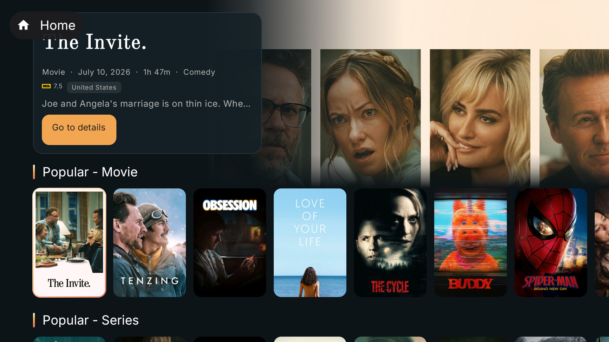
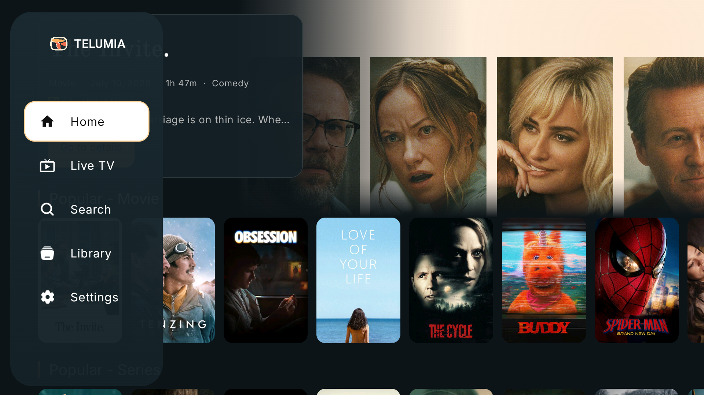
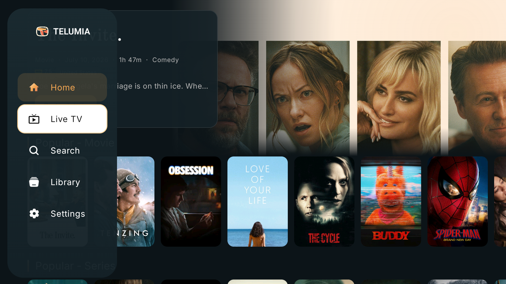
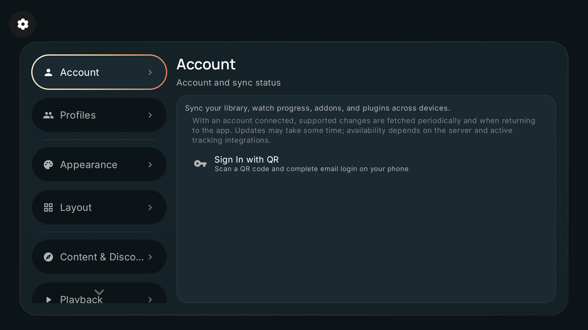

# Evolução visual Telumia TV

Esta entrega estende a atualização visual do Telumia para Android TV, com foco em leitura à distância, navegação por controle remoto e uma identidade consistente entre abertura, home e configurações.

## O que mudou

- A abertura revela a marca com entrada suave, escala e brilho ambiente; o movimento respeita as preferências de animação e redução de movimento do tema.
- A hero da home troca título e metadados com transição curta, recebe luz ambiente da paleta Telumia e oferece um botão de detalhes com foco visível. A ação usa o destino real do item focado e fica indisponível enquanto um trailer ocupa a tela.
- Os títulos das fileiras ganharam hierarquia maior e um acento vertical em âmbar/coral.
- A navegação lateral mostra o wordmark Telumia e mantém superfícies e contornos de foco legíveis para o controle remoto.
- O foco D-pad do menu lateral agora percorre alvos explícitos entre as rotas, sem escapar para os cartões da home.
- Os painéis compartilhados de configurações receberam gradientes discretos e contornos tingidos pela paleta de marca.

## Evidências no emulador

Capturas em 1920 × 1080, feitas no AVD `Telumia_TV_API33` com a variante de depuração:

O login QR do build de depuração não está configurado neste ambiente. A verificação visual foi feita após escolher “continuar sem conta” e o perfil Essential; isso permite abrir a home com conteúdo de catálogo de demonstração. A ação “ir aos detalhes” também foi exercitada pela navegação D-pad.

## Verificação

- `:app:assembleFullDebug :app:assembleFullDebugAndroidTest` — compilação bem-sucedida.
- `TelumiaHomeHeroTvTest` via `adb shell am instrument` direcionado ao AVD Android 13 TV — 3 testes, 0 falhas.
- `git diff --check` — sem erros de whitespace.
- AVD: Android 13, ABI x86. APK instalado: `app/build/outputs/apk/full/debug/app-full-x86-debug.apk` (depuração, assinatura de teste; o pacote `.debug` não atualiza o pacote estável instalado).
- SHA-256 do APK x86 validado: `61417914831DA41EA7D1C6915FC364270AD5A76ADD503562C0701CE2EF6801BB`.

O APK universal e os APKs por ABI gerados pelo Gradle também são artefatos `debug`; ainda não representam uma publicação estável.

## Referências de design

- [Android TV: design para TV](https://developer.android.com/design/ui/tv/guides/foundations/design-for-tv) — leitura à distância e apresentação de conteúdo na tela da TV.
- [Introdução a apps Android TV](https://developer.android.com/training/tv/start) — navegação e interação por controle remoto.
